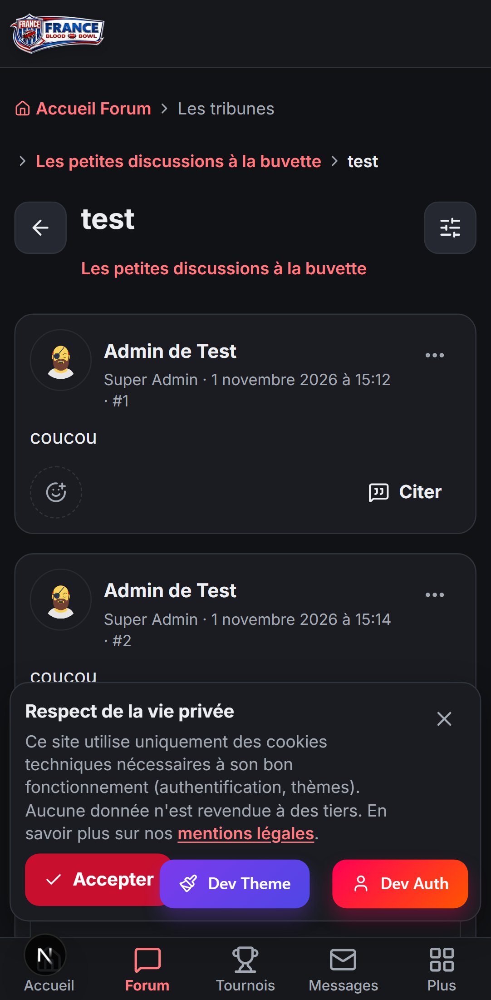
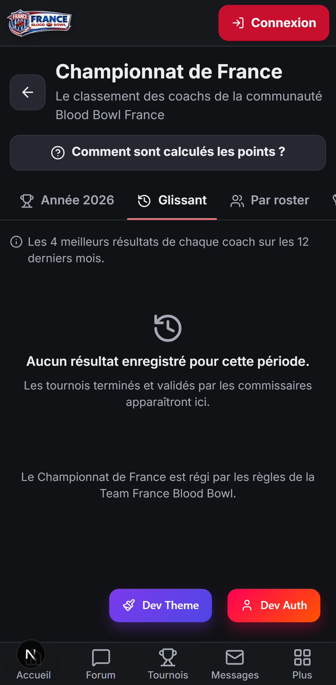

# Audit de BBFrance — 4 novembre 2026

Ce document fait le point sur l'état du site BBFrance : ce qui est solide, ce qui est cassé, ce qui est dangereux et ce qui manque. Il est écrit pour être lu par quelqu'un qui ne programme pas. Quand un mot technique est inévitable, il est expliqué sur place ou dans le petit lexique à la fin.

## Comment cet audit a été fait

Le code du site a été relu en entier par six relecteurs spécialisés : sécurité, fonctionnement du forum, confort du forum sur téléphone, fonctionnement des autres pages, confort des autres pages, et une visite du site en taille téléphone avec captures d'écran. Chaque problème grave a ensuite été **revérifié par un second relecteur** qui ne connaissait pas la conclusion du premier. Un seul constat est sorti affaibli de cette vérification (il est signalé en 3.1) ; tous les autres problèmes graves ont été confirmés en suivant le code ligne à ligne, et la faille la plus grave a été reproduite pour de vrai.

Ensuite, deux « conseils » ont discuté des priorités. Un conseil est un débat entre plusieurs points de vue joués par l'IA : coach sur téléphone, modérateur bénévole, organisateur de tournoi, ancien administrateur de forum, expert en sécurité, développeur seul, gardien des données personnelles. Le premier conseil portait sur le quiz et BBScheme (section 6), le second sur l'ordre des corrections du forum (section 7). Le responsable du site a tranché à chaque fois. Les comptes rendus sont dans `.claude/council/sessions/`.

Quelques mots reviennent souvent :
- le **CDF** est le Championnat de France de Blood Bowl, un classement national calculé à partir des tournois ;
- le **hub** est le futur service de connexion unique de BBFrance : il est prêt mais pas encore en ligne, si bien que le site gère aujourd'hui lui-même la connexion par Discord, Google ou e-mail ;
- un **ADR** est une fiche qui garde la trace d'une décision importante et de ses raisons (`docs/adr/`) ;
- le **kanban** est la liste des tâches du projet ; chaque tâche y est une « carte ».

Les problèmes déjà connus et notés dans le bilan du 1er novembre (`docs/bilans/2026-11-01-fin-de-refonte.md`) ne sont pas répétés ici.

Pour chaque problème, la mention *Où* indique le fichier concerné, pour la personne qui fera la correction. Les tailles de travail sont notées **S** (moins d'une heure), **M** (une demi-journée environ) ou **L** (plus).

---

## 1. L'essentiel

**Le site est globalement sain.** La refonte a laissé un code bien rangé, un affichage sur téléphone propre (aucun débordement sur les 17 pages visitées, des boutons assez grands partout) et des règles d'accès au forum regroupées en un seul endroit. Les messages privés sont chiffrés dans la base, les adresses e-mail des membres ne partent jamais vers le navigateur, et le rôle de chaque membre est relu à chaque visite.

**Mais cinq problèmes doivent être réglés avant toute autre chose :**

1. **Un membre peut piéger un message pour faire agir les autres à leur insu (section 2.1).** En combinant deux balises de mise en forme (les codes entre crochets comme `[b]` ou `[img]`), un membre peut glisser un petit programme caché dans un message, une signature ou un message privé. Ce programme se lance chez chaque lecteur. Si un administrateur le lit, il peut agir en son nom : changer des rôles, envoyer un e-mail à tous les membres, et même tenter d'effacer tout le site.
2. **On peut prendre le compte d'un autre membre via Discord (section 2.2).** Le site rattache un compte Discord à un compte existant sur la seule base de l'adresse e-mail, sans vérifier que cette adresse appartient bien à la personne. Le futur hub n'a pas ce défaut, mais il n'est pas encore en ligne.
3. **N'importe quel membre peut fausser le classement du Championnat de France (section 2.3).** Il suffit de créer un tournoi en cochant la case « CDF », puis de saisir des résultats inventés.
4. **La suppression d'un compte échoue dans un cas courant (section 4.1).** Quand deux coachs ayant joué le même tournoi suppriment leur compte, la base de données refuse la seconde suppression. Or tout membre a le droit de faire effacer ses données : c'est une obligation légale (le RGPD, voir lexique).
5. **Le texte des messages masqués par la modération reste lisible (section 2.4)**, par le bouton « Citer » ou en tapant une adresse. La modération est donc contournable.

À ces cinq points s'ajoute un geste simple à faire dès le premier jour : retirer le bouton qui efface tout le site (section 2.5).

**Le forum, cœur du site, a surtout un problème de « non-lus » (section 3.1) :** épingler ou déplacer un sujet le fait réapparaître comme nouveau pour tout le monde, lire la première page d'un long sujet le marque entièrement lu, et un nouveau membre voit tout le forum en non lu. Ce sont de petits défauts de tous les jours, qui se corrigent ensemble.

---

## 2. Sécurité

### 2.1 Un message piégé peut agir au nom de celui qui le lit — critique

**Ce qui se passe.** Le forum utilise le BBCode, un système de balises entre crochets comme `[b]gras[/b]` ou `[color=red]texte[/color]`, que le site transforme en mise en forme. Le site protège bien un texte isolé : si quelqu'un écrit du code dans un message, il est neutralisé. Mais quand on place une balise de couleur à l'intérieur d'une balise d'image, de galerie, de lien ou de citation, le site traite la couleur en premier, puis recopie le résultat dans l'image sans le vérifier. Un attaquant peut ainsi glisser une commande qui se lance à l'ouverture de la page. La faille a été reproduite : la formule produit bien du code actif.

**Ce que cela permet.** Le programme caché s'exécute chez chaque personne qui affiche le message, avec ses droits. Chez un membre, il peut modifier sa signature pour y recopier le piège : la faille se propage alors toute seule, de lecteur en lecteur. Chez un administrateur, il peut nommer l'attaquant administrateur. Chez le super administrateur, il peut lancer la remise à zéro du site (voir 2.5), dont la phrase de confirmation est affichée à l'écran.

**Où elle agit.** Messages du forum, signatures (affichées sous chaque message de leur auteur), messages privés, description des ligues, articles, page « Jouer ».

**Correction.** Traiter d'abord les balises qui produisent une adresse (image, galerie, lien, citation, schéma), refuser les guillemets et chevrons dans ces adresses, puis faire passer le résultat final dans un outil de nettoyage reconnu, qui retire tout code actif. Ajouter enfin une politique de sécurité du contenu (voir le lexique), qui empêche le navigateur d'exécuter un code qui ne vient pas du site. Il faudra aussi chercher dans la base si des messages piégés existent déjà. Si l'on en trouve, on déconnectera tous les membres par précaution, avec un bandeau d'explication. **Taille : M.**
*Où : `apps/site/lib/bbcode.ts` (balises `color`, `gallery`, `img`, `url`, `quote`) ; affichage dans `common/components/BBCodeContent/BBCodeContent.tsx`, `messagerie/component/ChatBubble.tsx`, `ligue/[id]/page.tsx`, `jouer/page.tsx`.*

### 2.2 Prise de compte par Discord ou Google — critique tant que le hub n'est pas en ligne

**Ce qui se passe.** Aujourd'hui, le site en ligne gère lui-même la connexion par Discord, Google ou lien par e-mail. Un réglage autorise le site à rattacher un compte Discord à un compte BBFrance existant **dès que les adresses e-mail sont identiques**. Or Discord laisse créer un compte avec une adresse que l'on n'a pas confirmée. Une personne malveillante peut donc créer un compte Discord avec l'adresse d'un coach, se connecter, et se retrouver dans le compte de ce coach. Si l'adresse est celle d'un super administrateur, elle obtient tous les droits.

Ce réglage avait pourtant été explicitement interdit dans une décision écrite du projet (ADR-0001). Le futur hub de connexion se protège déjà correctement contre ce cas ; c'est le site actuel qui ne le fait pas.

**Correction.** La vraie solution est de faire passer toute la connexion par le hub, ce que le code sait déjà faire : il manque seulement la mise en ligne du hub (carte 035). En attendant, refuser la connexion quand Discord ou Google indique que l'adresse n'est pas vérifiée. Ensuite, vérifier dans la base les comptes déjà rattachés, et prévoir une façon pour un modérateur de rendre son compte à un coach. **Taille : S.**
*Où : `apps/site/auth.ts` (réglage `allowDangerousEmailAccountLinking` et fonction `signIn`).*

### 2.3 Le classement national peut être falsifié — haute

**Ce qui se passe.** Le forum « Les tournois » est ouvert à tous les membres. Quand on y crée un tournoi, la case « Tournoi CDF » s'affiche pour tout le monde. Celui qui crée le tournoi en devient l'organisateur et peut saisir les résultats. Le site recalcule bien les points avec la formule officielle, mais à partir des rangs, des participants et du nombre de joueurs saisis par l'organisateur, sans aucune validation. Le classement compte ensuite tout tournoi « CDF » marqué terminé.

**Conséquence.** Un coach peut s'attribuer une victoire fictive, ou faire monter et descendre d'autres coachs.

**Correction.** Réserver la case CDF à des organisateurs accrédités, et faire passer les résultats CDF par une validation avant qu'ils comptent. Les résultats déjà saisis passent « en attente de validation ». **Taille : S à M.**
*Où : `app/forum/actions.ts` (création et modification d'un tournoi), `app/tournois/actions.ts` (`saveTournamentResults`), `app/classement/actions.ts` (`getRanking`).*

### 2.4 Le texte des messages masqués reste lisible — haute

Quand un modérateur masque un message, ou quand son auteur le supprime, l'écran affiche bien « message masqué ». Mais le texte complet est quand même envoyé au navigateur. On le retrouve de trois façons : le bouton « Citer », toujours présent sur un message masqué, recopie le texte original dans la réponse ; la page « Répondre » remplit l'éditeur avec n'importe quel message si l'on tape son numéro dans l'adresse ; et le rappel des trois derniers messages, sur la page de réponse, les affiche en clair.

**Correction.** Ne jamais envoyer le texte d'un message masqué ou supprimé, sauf à un modérateur, et refuser de le citer. **Taille : S.**
*Où : `app/forum/topic/[id]/page.tsx`, `app/forum/topic/[id]/reply/page.tsx`, `app/forum/component/ComposeScreen.tsx`, `app/forum/actions.ts` (`getPostById`, `getTopicLatestPosts`).*

### 2.5 Le bouton de remise à zéro du site — haute

L'administration contient un bouton qui efface tout : messages, sujets, forums, tournois, messages privés et tous les membres sauf les super administrateurs. La seule protection est une phrase à recopier, affichée juste à côté. Il n'y a ni sauvegarde préalable, ni trace dans le journal, ni blocage sur le site en ligne. Combiné à la faille 2.1, ce bouton devient une arme. Il est possible qu'il échoue sur la base actuelle, parce qu'il oublie d'effacer certaines données liées aux membres (articles, ligues). Mais on ne doit pas compter sur ce défaut pour se protéger : le bouton est à la fois dangereux et inutile.

**Correction.** Le retirer du site en ligne. **Taille : S (dix minutes).**
*Où : `app/administration/actions.ts` (`resetDatabase`) et l'onglet `ResetTab.tsx`.*

### 2.6 Autres points de sécurité

| Gravité | Problème | Correction | Taille |
|---|---|---|---|
| Moyenne | Un administrateur dont le compte est supprimé garde ses droits jusqu'à 30 jours, le temps que son jeton de session (voir lexique) expire. Même chose si la base ne répond pas : dans le doute, l'accès reste ouvert. *Où : `auth.ts`* | Fermer la session quand le membre n'existe plus ou quand la base est injoignable | S |
| Moyenne | Aucune limite de fréquence : un message avec 500 mentions (`@pseudo`) envoie 500 e-mails, le lien de connexion par e-mail peut être envoyé en boucle à n'importe qui, les signalements et les invitations en conversation sont illimités | Plafonner les mentions par message (10 par exemple) et compter les actions par membre | M |
| Moyenne | Pas de politique de sécurité du contenu (voir lexique). Les spoilers utilisent un code inséré dans le HTML qui empêche d'en mettre une stricte. *Où : `next.config.ts`, `lib/bbcode.ts`* | Réécrire les spoilers, puis ajouter la politique | M |
| Moyenne | Les e-mails de notification insèrent le titre du sujet et le nom de l'auteur sans précaution : un titre piégé peut glisser un faux lien dans l'e-mail (hameçonnage). Même problème pour les e-mails de messages privés et d'annonces. *Où : `lib/mail.ts`* | Neutraliser ces textes avant de les insérer | S |
| Faible | Un administrateur peut effacer tout le journal de modération en envoyant une durée négative. *Où : `moderation/actions.ts`* | Imposer au moins 3 mois côté serveur | S |
| Faible | Le pseudo n'est ni unique ni limité en longueur : on peut prendre le pseudo exact d'un modérateur | Unicité sans tenir compte des majuscules, longueur maximale | S |
| Faible | Un capitaine peut inscrire n'importe quel membre dans son équipe de tournoi sans son accord | Ne proposer que des membres volontaires | S à M |
| Faible | Un administrateur peut contourner la limite de puissance des rôles personnalisés en envoyant une liste incomplète. *Où : `administration/actions.ts`* | Refuser une liste incomplète ou un rôle inconnu | S |

**Ce qui est bien fait.** Les adresses e-mail ne quittent jamais le serveur. Le rôle et le bannissement sont relus dans la base à chaque visite : un membre ne peut pas s'attribuer un rôle. Personne ne peut lire une conversation privée dont il ne fait pas partie, et ces messages sont chiffrés dans la base. L'envoi d'images vérifie le vrai type du fichier. Les échanges avec le futur hub sont signés.

---

## 3. Le forum

Le forum est la raison d'être du site. Il est déjà agréable à utiliser sur téléphone : écrans de rédaction en plein écran, barre d'envoi à portée de pouce, boutons de bonne taille, et ouverture d'un sujet directement au premier message non lu. Voici ce qui le gêne encore.

### 3.1 Les bugs qui touchent tout le monde

**Les « non-lus » sont peu fiables — haute.** C'est le défaut le plus visible au quotidien. Il a quatre causes :

- **Épingler, verrouiller, archiver, déplacer ou renommer un sujet le remet « non lu » pour tous les membres** et le fait remonter en tête de liste, alors que personne n'y a écrit. Un vieux sujet de 2019 que l'on épingle apparaît comme une nouveauté. La cause : la base note la date de *toute* modification du sujet, pas seulement celle du dernier message. Or c'est cette date qui sert au tri et au non-lu.
- **Lire la page 1 d'un sujet de 15 pages le marque entièrement lu.** Le lendemain, le coach reprend au premier message publié depuis, et les pages 2 à 14 qu'il n'a jamais lues sont sautées sans prévenir.
- **Après avoir répondu, son propre sujet apparaît non lu.** Et revenir sur un sujet sans recharger la page ne le marque plus lu : le navigateur garde en mémoire que le sujet a déjà été ouvert et ne prévient plus le serveur.
- **Un nouveau membre voit tout le forum en non lu**, y compris les milliers de sujets importés de l'ancien forum. Le bouton « Tout marquer lu » traite alors chaque sujet un par un, ce qui est lent et peut échouer.

**Correction, en une seule fois :**
1. noter pour chaque sujet la date et l'auteur de son *dernier message*, et s'en servir pour le tri, le non-lu et l'affichage « dernier message par… » ;
2. mémoriser pour chaque membre le dernier message qu'il a réellement eu sous les yeux ;
3. ajouter une date « tout est lu avant le… », posée à l'inscription et par le bouton « Tout marquer lu ».

C'est ainsi que fonctionnent les grands logiciels de forum. **Taille : M.**
*Où : `prisma/schema.prisma` (modèle `Topic`), `app/forum/actions.ts` (`markTopicAsRead`, `createPost`, `markAllTopicsAsRead`), `app/forum/unreadState.ts`, `app/forum/component/MarkAsRead.tsx`.*

**L'auteur d'un sujet peut effacer définitivement les réponses des autres — haute.** L'action « supprimer le sujet » est réservée aux modérateurs à l'écran, mais le serveur l'accepte aussi de l'auteur. Après une dispute, il peut faire disparaître 80 réponses ; si le sujet porte un tournoi, le tournoi, les inscriptions et les résultats du classement partent avec. Le message de confirmation ne parle même pas du tournoi.
**Correction.** Remplacer cette suppression par une suppression « douce » (le contenu est marqué supprimé au lieu d'être effacé), réservée aux modérateurs, restaurable et inscrite au journal. **Taille : S.**
*Où : `app/forum/actions.ts` (`deleteTopicPermanent`).*

**Des notifications par e-mail se perdent — moyenne.** Les e-mails de mention, de suivi de sujet et de message privé sont lancés sans que le site attende leur envoi. Chez l'hébergeur du site, le serveur peut s'arrêter avant : certains e-mails ne partent jamais, au hasard. De plus, une mention ou un abonnement prévient un membre même s'il n'a pas accès au forum concerné, ce qui lui révèle le titre d'un sujet réservé. Et une mention placée dans le premier message d'un sujet, ou ajoutée en modifiant un message, ne prévient personne.
**Correction.** Utiliser l'outil prévu pour finir un travail après avoir répondu au membre, filtrer les destinataires selon leurs droits, et lire les mentions à la création et à la modification. **Taille : M.**

**Données personnelles envoyées avec chaque message — moyenne.** *Constat affaibli par la vérification : le premier relecteur pensait que les adresses e-mail partaient aussi, mais elles sont bien protégées.* La page d'un sujet envoie au navigateur toute la fiche de chaque auteur et de chaque inscrit au tournoi : motif de bannissement, préférences de notification, identifiant sur l'ancien forum, scores du quiz. N'importe quel visiteur peut les lire dans le code de la page.
**Correction.** Ne charger que le nom, l'avatar, le rôle et la signature. **Taille : S.**

**Autres bugs du forum**

| Gravité | Problème | Taille |
|---|---|---|
| Moyenne | Un sujet archivé accepte encore des réponses, qui n'apparaissent nulle part | S |
| Moyenne | Supprimer un forum laisse les tournois qu'il contenait, avec des liens morts, et une panne au milieu laisse un forum à moitié vidé | S |
| Moyenne | Le lien « voir le message cité » ne marche que si le message est sur la même page ; et on peut écrire à la main une fausse citation attribuée à un autre membre | S |
| Moyenne | Aucune limite de longueur : message fait seulement d'espaces, titre vide après renommage, message géant qui ralentit l'affichage | S |
| Faible | « Supprimer » annonce une suppression « définitive et irréversible », alors que le message est seulement remplacé par « supprimé par son auteur » | S |
| Faible | Un double appui peut créer deux réactions identiques ; le nombre de sujets de l'accueil compte les sujets archivés ; `/forum/unread?page=abc` affiche une page cassée | S |

### 3.2 Les illogismes

- **« Dernier message par Jean » affiche en réalité l'auteur du sujet**, pas celui du dernier message. Les dates sont sans heure : on ne sait pas si c'est récent. Réglé avec la correction des non-lus.
- **Un modérateur ne peut pas supprimer un spam**, seulement le masquer : 50 messages d'un robot restent affichés comme 50 encarts. Il ne peut pas non plus scinder ou fusionner des sujets.
- **Chercher un mot du titre renvoie tous les messages du sujet** : chercher « Nuffle » ressort les 300 messages du sujet « Nuffle ».
- **L'auteur d'un sujet n'est pas abonné à ses réponses** : un coach qui pose une question de règles n'est pas prévenu qu'on lui a répondu, sauf s'il pense à cliquer sur « Suivre ».
- **Supprimer le premier message d'un sujet laisse un sujet vide**, avec un titre et « ce message a été supprimé ».
- **« Marquer comme non lu » renvoie à l'accueil du forum**, alors que le coach voulait seulement poser un marque-page.

### 3.3 La modération

**Un signalement de message est inexploitable — haute.** Dans l'écran de modération, un message signalé n'apparaît que sous la forme « Contenu 3f2a9b1c… » : ni le texte, ni l'auteur, ni de lien pour aller le voir. Le modérateur doit retrouver le message à la main, le masquer, puis revenir fermer le signalement. Pour les autres contenus, le bouton « Voir » ouvre un nouvel onglet, pénible sur téléphone.
**Correction.** Une carte par signalement, avec l'extrait du message, son auteur, un lien vers lui dans le même onglet, et trois gros boutons : « Masquer », « Ignorer », « Voir dans le sujet ». Masquer ferme le signalement automatiquement. **Taille : M.**
*Où : `app/moderation/component/ReportsTab.tsx`, `app/moderation/actions.ts`.*

Autres points : épingler ou archiver ne donne aucun retour visible et laisse le panneau ouvert ; les signalements d'un contenu supprimé restent « en attente » ; un modérateur peut modifier le message d'un autre sans que cela laisse de trace.

### 3.4 Le confort sur téléphone

**Naviguer dans un long sujet est pénible — haute.** La barre de pages ne propose que « précédente », « suivante » et « dernière ». Revenir de la page 15 à la page 1 demande 14 appuis, et on ne peut pas sauter à la page 8.
**Proposition.** Rendre « Page 3 sur 15 » touchable, pour ouvrir un panneau avec la liste des pages, « Première page » et « Dernier message ». **Taille : S à M.**

**Pas de brouillon : un long message peut être perdu — haute.** Un geste de retour fait par erreur, un appel entrant, un onglet rechargé par le téléphone, et le compte rendu de tournoi tapé pendant vingt minutes disparaît. « Annuler » ne demande même pas de confirmation.
**Proposition.** Enregistrer le brouillon dans le téléphone toutes les quelques secondes, le restaurer avec un bandeau « Brouillon restauré · Effacer », et confirmer avant d'annuler un texte non vide. **Taille : S.**

**Ajouter une photo prise avec le téléphone demande 5 à 6 gestes — haute.** L'outil Image ouvre le clavier sur le champ « adresse de l'image », qui recouvre justement le bouton « Envoyer une image depuis l'appareil ». Une seule photo à la fois.
**Proposition.** Sur téléphone, un gros bouton « Choisir une photo » en premier, plusieurs photos d'un coup, et la progression de l'envoi visible. **Taille : S.**

**Rien n'invite le visiteur à participer — haute pour faire grandir la communauté.** Un visiteur lit les sujets, mais nulle part il ne voit « Connectez-vous pour répondre ». La zone de réponse disparaît simplement.
**Proposition.** Un encart « Envie de participer ? Se connecter ou créer un compte » en bas de chaque sujet, avec retour au sujet après la connexion. **Taille : S.**

**« Citer » prend tout le message — moyenne.** Les citations s'empilent en pyramide, et le coach doit effacer à la main, sur un petit écran, ce qui ne l'intéresse pas. Après « Citer », la page descend jusqu'à la réponse et la position de lecture est perdue.
**Proposition.** Citer seulement le passage sélectionné, retirer les citations imbriquées, garder la position. **Taille : M.**

**Autres points de confort**

- Le haut d'un sujet est encombré : le fil d'Ariane (le chemin « Accueil Forum › catégorie › forum › sujet ») prend deux à trois lignes, puis le titre et le forum sont répétés. Sur la capture ci-dessous, un chevron se retrouve seul en début de ligne, et le « #1 » du message passe seul à la ligne.
- Le bandeau des cookies occupe un cinquième de l'écran et recouvre la barre « Annuler / Publier » de l'écran de réponse.
- Les signatures s'affichent en entier sous chaque message : sur 20 messages, cela fait beaucoup à faire défiler.
- Les citations imbriquées sont en italique gris, avec une marge à chaque niveau : à trois niveaux, il reste peu de place et c'est fatigant à lire.
- Les images et vidéos placées à gauche ou à droite d'un texte restent côte à côte sur téléphone : la vidéo fait 150 pixels de large et le texte est écrasé.
- L'onglet « Forum » de la barre du bas n'a pas de pastille de nouveaux messages, alors que « Messages » en a une.
- « Partager » copie seulement un lien, sans ouvrir le menu de partage du téléphone (Discord, WhatsApp…), et sans message si la copie échoue.
- On ne peut pas voir qui a réagi à un message.
- La recherche est rangée tout en bas de l'accueil du forum, et ne trouve que la phrase exacte : « nains chaos » ne trouve pas « Nains du Chaos ».

### 3.5 La rapidité

Le forum est rapide aujourd'hui, parce qu'il contient peu de messages. Plusieurs choix le ralentiront quand il grandira :

- **Le calcul des non-lus relit tous les sujets du forum à chaque page affichée.** Avec 10 000 sujets, cela fait 10 000 lignes lues pour afficher une liste. La correction des non-lus (3.1) permet de faire ce calcul directement dans la base, en une seule demande.
- **Des « index » manquent dans la base** (un index est comme le sommaire d'un livre : il permet de trouver une ligne sans tout relire). Il en faut pour la liste des sujets d'un forum triée par date, pour la pagination d'un sujet, et pour retrouver les abonnés d'un sujet à chaque nouvelle réponse : aujourd'hui, cette dernière recherche parcourt toute la table des abonnements. **Taille : S.**
- **La recherche relit tous les messages**, deux fois, à chaque recherche. Le logiciel de base de données du site sait faire une vraie recherche en français, qui comprend les accents et les pluriels : c'est la bonne solution à terme. **Taille : M.**
- **La mise en forme des messages est calculée deux fois** : une fois sur le serveur, puis à nouveau dans le téléphone, et encore à chaque petite interaction. Le lecteur de schémas BBScheme est aussi téléchargé sur chaque page de sujet, même sans schéma. Faire ce calcul seulement sur le serveur allégerait les pages. **Taille : M.**
- La page d'un sujet fait encore quelques demandes inutiles à la base : les réglages des rôles sont lus deux fois, l'état « je suis ce sujet » est demandé après l'affichage, et tout le sujet est chargé avant même de vérifier que le lecteur a le droit de le voir. Les compteurs de messages sont recalculés à chaque fois au lieu d'être stockés.

Le cache de l'accueil du forum (une copie gardée 60 secondes) fonctionne bien, et la page d'un sujet est déjà passée de 89 à 46 demandes à la base grâce aux cartes précédentes.

### 3.6 Ce qui manque pour en faire un excellent forum

Classés du plus utile au moins utile pour une communauté de taille modeste :

| Ajout | Pourquoi | Intérêt | Taille |
|---|---|---|---|
| Notifications dans le site (une cloche) | Mentions et réponses aux sujets suivis, sans dépendre des e-mails qui se perdent. La liste des mentions existe déjà dans la base, mais aucune page ne la montre | Fort | M |
| Abonnement automatique à ses sujets et à ceux où l'on répond | C'est ce qu'attend un coach qui pose une question | Fort | S |
| Brouillons | Voir 3.4 | Fort | S |
| Lien permanent vers un message | Répare les citations et rend le partage et les e-mails fiables | Fort | S |
| Page « Activité récente » de tout le forum | Sur un petit forum, c'est souvent la page la plus consultée | Fort | S |
| Reprendre sa lecture là où on l'a laissée, avec un trait « Nouveaux messages » | Le plus grand gain de confort pour les longs sujets | Fort | M |
| Mentions qui apparaissent sous le texte pendant la frappe de « @ju… » | Plus besoin de passer par un autre champ | Moyen | M |
| Sondages | Choisir une date de tournoi, voter une règle de ligue | Moyen | M |
| Sujet « résolu » dans le forum des règles | Les mêmes questions reviennent souvent | Moyen | S |
| Historique des modifications, visible des modérateurs | Aujourd'hui, un message peut être réécrit après coup sans trace | Moyen | M |
| Étiquettes (édition des règles, plateau ou en ligne, équipe) | Filtrer sans multiplier les sous-forums | Moyen | M |
| Résumé de la semaine par e-mail | Fait revenir les membres occasionnels | Moyen | M |
| Pièces jointes (règlement en PDF, roster) | Seules les images passent aujourd'hui | Moyen | L |
| Sujets populaires de la semaine, flux RSS, aperçu des liens | Confort | Faible | S à M |

La possibilité d'ignorer un membre existe déjà.

---

## 4. Les autres fonctionnalités

### 4.1 Tournois et classement

C'est la deuxième fonctionnalité du site, et la plus fragile après le forum.

- **La suppression de compte est bloquée par le classement — critique.** Quand un compte est supprimé, ses résultats de tournoi sont gardés, mais le nom du coach devient « Coach anonyme ». Or la base interdit deux résultats avec le même nom dans un même tournoi. Dès qu'un deuxième coach du même tournoi supprime son compte, la suppression est refusée et le membre voit « Une erreur est survenue ». Quand le hub sera en ligne, sa demande de suppression échouera en boucle. Cela peut même arriver pour un seul coach, s'il apparaît deux fois dans les résultats d'un même tournoi. **Correction :** donner un nom anonyme unique (« Coach anonyme 7f3a »). **Taille : S.** *Où : `lib/accountDeletion.ts`.*
- **Tous les coachs supprimés sont additionnés en un seul — haute.** Le classement reconnaît un coach par son numéro NAF (le numéro de l'association internationale des joueurs de tournoi), ou à défaut par son nom. Tous les « Coach anonyme » sans numéro sont donc fusionnés en un faux coach qui peut monter dans le classement. Pour la même raison, un coach saisi une fois avec son numéro et une fois sans apparaît sur deux lignes, et deux homonymes sans numéro sont confondus. **Correction :** reconnaître d'abord le compte lié, puis le numéro, puis le nom. **Taille : S à M.**
- **Changer un tournoi d'individuel à « par équipes » efface toutes les inscriptions — haute**, sans avertissement et sans prévenir les inscrits. **Taille : S.**
- **Un rang laissé vide donne les points du vainqueur — moyenne.** Si l'organisateur efface par erreur le rang d'un coach dans la saisie des résultats, le site lui donne le nombre de points du premier. **Taille : S.**
- **Aucune règle n'est vérifiée sur les équipes — moyenne** : un coach peut être dans deux équipes, une équipe peut dépasser la taille prévue, et un capitaine peut créer plusieurs équipes.
- **Personne ne sort de la liste d'attente** quand une place se libère, et personne n'est prévenu.
- **Le nombre de places n'est pas compté pareil** à l'inscription et à l'affichage : un tournoi importé peut afficher « 30/30 » et accepter encore des inscriptions.
- **Un tournoi en cours disparaît des listes** : sur l'accueil et la carte, un tournoi disparaît dès son premier jour ; sur la liste des tournois, dès son deuxième jour. À l'inverse, la fiche d'une ligue affiche pour toujours comme « à venir » un tournoi passé dont personne n'a saisi les résultats. **Correction :** une seule règle partagée, à l'heure de Paris. **Taille : S.**
- Un tournoi annulé ne peut plus être « désannulé », et ses résultats comptent quand même au classement. Si le nombre de rondes n'est pas saisi, le site en suppose 3 par jour, ce qui fausse le calcul des points. Une date de fin avant la date de début est acceptée.
- **Illogisme de parcours :** pour organiser un tournoi, il faut passer par le forum, et la fiche du tournoi est en réalité le premier message d'un sujet. Supprimer le sujet supprime le tournoi. Une vraie page « Créer un tournoi » serait plus claire (**taille L**).
- **Ce qui manque le plus :** l'historique des tournois et des résultats CDF sur la fiche de chaque coach, et des notifications à l'organisateur et aux inscrits.

### 4.2 Messagerie

- **Une nouvelle conversation peut atterrir dans une conversation vide — haute.** Quand l'un des deux participants supprime son compte, la conversation reste avec un seul membre. La recherche de « conversation existante » la prend alors pour la bonne : le nouveau destinataire n'est jamais ajouté, et dans un cas il reçoit même l'identifiant de la conversation d'un autre membre. **Taille : S.**
- **Quitter une conversation à deux l'efface aussi chez l'autre**, sans le prévenir. **Taille : S.**
- **Dans un groupe, le premier qui lit marque le message lu pour tout le monde.** Les pastilles de non-lus et les e-mails de rappel sont donc faux. **Taille : M.**
- La page n'a pas de bouton retour, contrairement aux autres. La liste des conversations n'est pas découpée en pages.

### 4.3 Profil, membres et bannissement

- Un membre banni garde ses inscriptions aux tournois (il prend une place), reste chef de ligue ou commissaire, et peut encore recevoir des messages privés.
- Le capitaine d'une équipe dont le compte est supprimé laisse une équipe que personne ne peut plus gérer.
- L'annuaire des membres n'est accessible que depuis la colonne du forum : il n'apparaît ni dans le menu « Plus » ni sur l'accueil.
- Sur le profil, la case « NAF — » est vide sans explication, et les onglets touchent le bord de l'écran.
- Un super administrateur qui supprime son propre compte garde ses droits dans sa session ouverte.

### 4.4 Ligues

- Supprimer une ligue efface son nom sur les tournois et articles qui y étaient rattachés.
- Chaque membre déclare lui-même sa ligue, depuis son profil : le chef de ligue ne peut ni valider ni retirer un membre.
- **Ce qui manque le plus :** le calendrier et les résultats propres à la ligue (la fiche ne montre que cinq tournois).

### 4.5 Articles, ressources, médias

- Quand un modérateur corrige une faute dans une ressource déjà validée, elle repasse « en attente » et disparaît du site.
- Une ressource refusée l'est sans explication, et l'auteur d'un article masqué n'est pas prévenu.
- **La page Médias est vide** : les chaînes Twitch et YouTube qu'elle affiche ne se règlent nulle part dans l'administration.
- Trois pages se partagent « débuter et s'équiper » (Jouer, Ressources, Médias), avec trois façons différentes d'en gérer le contenu. Une seule page « Débuter » serait plus claire.

### 4.6 Administration et annonces

- **La case « Newsletter et annonces » du profil n'a aucun effet** : les annonces partent à tous les membres, y compris ceux qui ont décoché la case. C'est contraire au consentement affiché. De plus, les envois ratés sont comptés comme réussis, et l'envoi d'un e-mail toutes les demi-secondes risque de dépasser le temps maximal accordé au serveur (ce point est déjà prévu dans une tâche du kanban, la carte 145).
- La purge du journal de modération efface aussi la date et l'auteur des bannissements anciens.
- Deux actions différentes servent à changer le rôle d'un membre : l'une écrit au journal, l'autre non.
- Les statistiques comptent les bannis et le compte « fantôme » qui sert à anonymiser, et affichent un quota d'envoi d'e-mails d'un service qui n'est plus utilisé.

### 4.7 Accueil, navigation et premier contact

- **Aucun écran de chargement ni d'erreur de secours.** Sur une connexion lente, un appui sur un onglet ne montre rien pendant que la page se prépare, comme si l'appui avait raté. Si la base ne répond pas, le coach voit une page d'erreur brute en anglais, sans bouton pour réessayer. **Taille : S à M.**
- **Le visiteur ne voit nulle part « S'inscrire »**, seulement « Connexion », ce qui suppose qu'il a déjà un compte. Sur téléphone, la phrase qui explique le site est masquée, et aucun chiffre ne montre que la communauté est vivante (nombre de coachs, de ligues, de tournois à venir).
- **L'onglet « Plus » ne s'allume jamais** sur les neuf pages qu'il contient (Ligues, Classement, Articles…) : le coach ne sait plus où il est. À l'inverse, quand le panneau est ouvert sur l'accueil, deux onglets sont allumés en même temps.
- Le panneau « Plus » place le choix du thème avant les rubriques, et range ses dix rubriques autrement que l'accueil. Le bouton « Déconnexion » est collé aux liens du bas de page.
- Si l'invitation Discord n'est pas réglée, les boutons « Discord » de l'accueil ne mènent nulle part.
- L'inscription demande un long formulaire alors que seul le pseudo est obligatoire, et parle de « Numéro NAF » et de « Signature (BBCode) » sans les expliquer.
- Petits textes : la page d'erreur de connexion affiche « ID Erreur: Verification », un code brut ; la page de connexion propose un « lien magique », alors que « lien de connexion par e-mail » serait plus clair.
- Accessibilité : pas de lien « aller au contenu » pour les personnes qui naviguent au clavier, et certains textes gris de 12 à 13 pixels sont à la limite du lisible dans les thèmes peu contrastés.
- Sur téléphone, des textes sont coupés : le champ de recherche (« Rechercher des messages ou des »), le tri des tournois (« Date (plus proche »), les onglets du classement et du profil.

**Ce qui est bien fait.** Une seule liste de navigation alimente la barre du bas, le panneau « Plus » et la barre d'ordinateur. Les pages de liste se ressemblent toutes : même en-tête, même message avec une action proposée quand la liste est vide, mêmes silhouettes grises pendant le chargement. La page 404 a du caractère (« Terrain impraticable ! »). Aucune page ne déborde en largeur sur téléphone.

---

## 5. Idées d'ajouts pour tout le site

| Idée | Pour qui | Intérêt | Taille |
|---|---|---|---|
| Écrans de chargement et d'erreur aux couleurs du site | Tous | Fort : le site paraît plus rapide pour un coût faible | S à M |
| Bloc « Pour vous » sur l'accueil d'un membre connecté : mes prochains tournois, mes messages non lus, ma ligue | Membres | Fort : donne une raison de revenir chaque jour | M |
| Accueil des nouveaux venus : bandeau d'explication, bouton « Rejoindre la communauté », sujet épinglé « Présentez-vous » | Visiteurs | Fort pour la croissance | S |
| Historique des tournois et résultats CDF sur la fiche publique d'un coach | Coachs de tournoi | Fort | M |
| Inscription en deux temps : pseudo seul, puis rappels doux « profil complété à 3 sur 5 » | Nouveaux membres | Moyen : moins d'abandons | M |
| Une seule organisation des rubriques (Débuter, Compétition, Communauté) partagée par l'accueil, « Plus » et la barre d'ordinateur | Tous | Moyen | M |
| Recherche globale (ligues, tournois, membres, articles) : on tape « Lyon » et on trouve tout | Tous | Moyen | L |
| Notifications aux organisateurs et inscrits (inscription, sortie de liste d'attente) | Organisateurs | Moyen | M |

---

## 6. Le quiz et BBScheme

**Ce qui est décidé.** Le quiz (BBQuizz) et l'éditeur de schémas tactiques (BBScheme) quittent le site pour devenir deux applications à part, dans `apps/bbquizz` et `apps/bbscheme`. Ils alourdissent le site, alors qu'ils n'ont rien à voir avec le forum. Leur relance sera traitée plus tard.

**Ce que cela change pour les coachs.**
- Le quiz et l'éditeur disparaissent du menu et de l'accueil.
- **Les schémas déjà publiés dans le forum, les articles et les messages privés restent affichés.** Le site les demandera à l'application BBScheme par une petite adresse en lecture seule. Si celle-ci ne répond pas, le schéma est remplacé par « Schéma indisponible », sans casser la page.
- En attendant la relance de l'éditeur, on ne peut plus créer de nouveau schéma : l'outil d'insertion de l'éditeur de messages et le bouton « Ouvrir dans l'éditeur » sont masqués.

**Les précautions retenues.** Le premier conseil proposait de ne rien déplacer. Le responsable a maintenu la sortie des deux outils, en retenant trois précautions issues du débat :
1. **Pas de schémas indisponibles.** L'application BBScheme, réduite à son adresse de lecture, est mise en ligne avec sa propre base **avant** que les tables soient retirées du site.
2. **Un seul exemplaire du code.** Les fichiers sont déplacés, pas copiés : il n'y aura jamais deux versions du même code.
3. **Aucune perte de données.** Avant toute suppression de table : une sauvegarde complète de la base, le transfert des données vers les nouvelles bases, puis la comparaison du nombre de lignes avant et après. Les données du quiz et des schémas restent couvertes par l'export et l'effacement des données personnelles, en lien avec le travail en cours sur le RGPD (les règles européennes de protection des données).

La décision ADR-0001 avait jugé le quiz « soudé au forum » et refusé de l'extraire. Une nouvelle décision (ADR-0008) remplacera cette ligne.

---

## 7. Plan d'action

Ce plan reprend la proposition du second conseil (celui sur le forum), validée par le responsable avec deux ajustements : on ne déconnecte tous les membres que si l'on trouve des messages piégés en base, et les notifications dans le site passent en tête des ajouts.

**Premier jour**
- Retirer le bouton de remise à zéro du site.
- Vérifier qu'une sauvegarde de la base se restaure réellement (ne pas se contenter de savoir qu'elle existe).
- Ajouter les index manquants.

**Semaine 1 — sécurité**
- Corriger la faille du BBCode, ajouter la politique de sécurité du contenu, chercher les messages piégés en base ; déconnecter tout le monde, avec un bandeau d'explication, seulement si on en trouve.
- N'accepter Discord et Google qu'avec une adresse vérifiée, puis vérifier les comptes déjà rattachés.
- Geler les résultats CDF : ceux déjà saisis ne comptent plus tant qu'ils ne sont pas validés ; ensuite, seuls des organisateurs accrédités créent des tournois CDF, et leurs résultats sont validés avant de compter.
- Corriger la suppression de compte (nom anonyme unique) et le faux « Coach anonyme » du classement.
- Fermer la session d'un membre supprimé.

**Semaine 2 — intégrité et modération**
- Suppression douce des sujets, réponses et tournois, réservée aux modérateurs et restaurable.
- Texte des messages masqués retiré côté serveur ; fiches d'auteur réduites au strict nécessaire.
- Signalements lisibles et actionnables.
- Non-lus : dernier message enregistré, date « tout est lu avant le… », position de lecture.
- E-mails : envoi attendu, textes neutralisés, destinataires filtrés selon leurs droits, préférence « Newsletter » respectée.
- Messagerie : conversation orpheline et « quitter » qui efface chez l'autre.
- Un message de l'équipe aux membres pour expliquer les changements.

**Semaine 3 — confort du forum**
- Brouillons, notifications dans le site, abonnement automatique.
- Pagination sur téléphone (début, fin, saut de page), citation d'un passage.
- Photos depuis le téléphone, encart pour les visiteurs.

**Ensuite**
- Sortie de BBScheme, puis du quiz (section 6).
- Tournois : équipes, liste d'attente, dates, création hors forum.
- Accueil et navigation : écrans de chargement, « S'inscrire », onglet « Plus ».
- Recherche plein texte en français.

**Décisions du responsable (4 novembre 2026)**
- **Connexion :** tout doit passer par le hub. Le site garde une connexion directe seulement parce que le hub n'est pas encore en ligne (carte 035). En attendant, la faille 2.2 est corrigée en secours (carte 160), puis la connexion directe sera retirée du site (carte 161).
- **Notifications :** un système de notifications interne au site. Les e-mails sont réservés à la messagerie privée, aux sujets suivis et aux e-mails de modération et d'administration ; les mentions restent dans le site (carte 167).
- **Illogismes du forum (section 3.2) :** tous corrigés (carte 169).
- **Organisateurs CDF :** ce sont les modérateurs et les administrateurs qui accréditent et valident (carte 162).
- **Date « tout est lu avant le… » :** pour les membres actuels, la date de mise en ligne de la correction. Les sujets jamais ouverts deviennent lus, ce qui a déjà été lu ne change pas (carte 166).
- **Messages piégés trouvés en base :** ils sont supprimés (carte 159).

Les corrections sont suivies dans l'épopée E10 du kanban, cartes 158 à 170.

---

## 8. Petit lexique

- **BBCode** : balises entre crochets (`[b]`, `[img]`, `[quote]`) que l'on tape dans un message pour le mettre en forme.
- **ADR** : fiche qui garde la trace d'une décision importante du projet et de ses raisons.
- **Cache** : copie d'une page ou d'un résultat gardée un moment, pour ne pas la recalculer à chaque visite.
- **CDF** : Championnat de France de Blood Bowl, classement national calculé à partir des tournois.
- **Faille d'injection de script (XSS)** : un défaut qui permet de cacher un petit programme dans un contenu publié ; il s'exécute ensuite chez chaque personne qui affiche ce contenu, avec ses droits.
- **Hub** : le futur service de connexion unique de BBFrance, prêt mais pas encore en ligne.
- **Index** : dans une base de données, un sommaire qui permet de retrouver des lignes sans tout relire.
- **Jeton de session** : le petit fichier que le navigateur garde après la connexion, pour que le site reconnaisse le membre à chaque visite.
- **Kanban** : la liste des tâches du projet, où chaque tâche est une « carte ».
- **Mention** : l'écriture `@pseudo` dans un message, qui prévient le membre cité.
- **NAF** : l'association internationale des joueurs de tournoi de Blood Bowl ; chaque coach inscrit y a un numéro.
- **Pagination** : le découpage d'un long sujet ou d'une longue liste en pages.
- **Politique de sécurité du contenu (CSP)** : une règle envoyée au navigateur qui lui interdit d'exécuter un code ne venant pas du site. Elle limite fortement les dégâts d'une faille d'injection.
- **RGPD** : le règlement européen sur la protection des données personnelles (droit d'accès, d'export, d'effacement).
- **Suppression douce** : on marque un contenu comme supprimé au lieu de l'effacer, ce qui permet de le restaurer.
